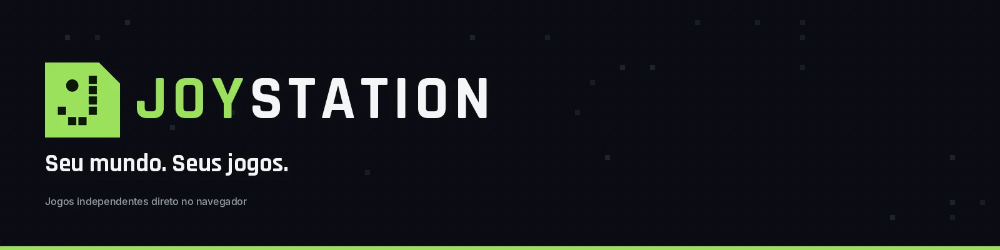
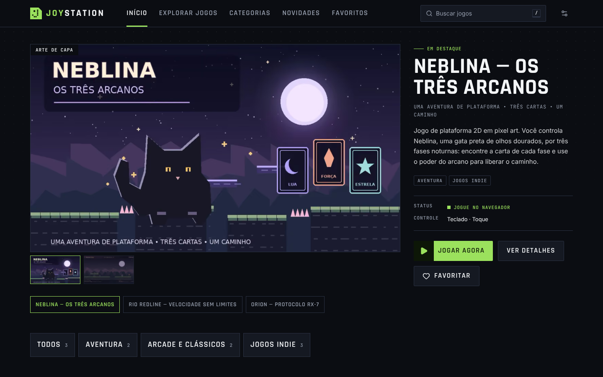
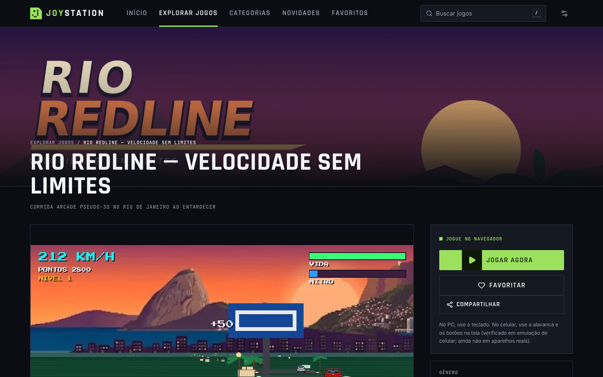
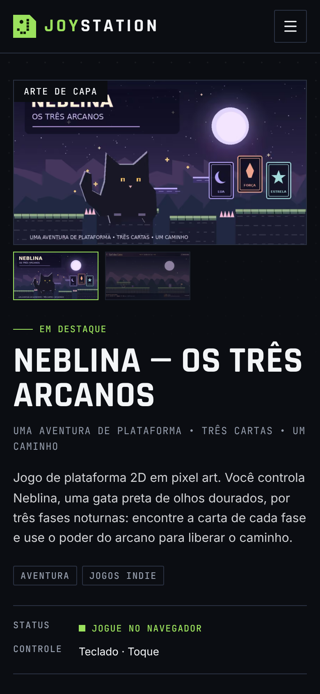

<p align="center"></p>

# JoyStation

**Seu mundo. Seus jogos.** Plataforma gamer para descobrir, jogar e acompanhar jogos independentes direto no navegador, sem cadastro.

> Evolução do projeto "Game Hub". O repositório ainda pode aparecer com o nome antigo até ser renomeado (ver "Renomear o repositório").

| Home | Página do jogo | Celular |
| --- | --- | --- |
|  |  |  |

## O que tem

- Catálogo com 3 jogos jogáveis no navegador: ORION — Protocolo RX-7, NEBLINA — Os Três Arcanos e RIO REDLINE.
- Destaques alternáveis na Home, busca (título, desenvolvedor, gênero, tags), 10 categorias (só aparecem as que têm jogo), Novidades e radar editorial.
- Biblioteca local: favoritos, histórico, "continue jogando", remover item e limpar com confirmação.
- Página de jogo com mecânicas, controles, créditos, compartilhar e capturas.
- Página **Criadores** (`/criadores`, dados em `data/creators.ts`).
- Página **JoyStation Developers** (`/desenvolvedores`) explicando como publicar um jogo.
- Sem login, sem cadastro, sem banco de dados, sem estatísticas inventadas.

## Stack

Next.js 16 (App Router, SSG) · React 19 · TypeScript · Tailwind CSS 4 · lucide-react · fontes auto-hospedadas (@fontsource). Jogos em HTML/Canvas dentro de iframe do mesmo domínio.

## Arquitetura

- `config/brand.ts`: nome, tagline, URLs, chaves de armazenamento. Fonte única da identidade.
- `data/games.ts`: catálogo tipado. A disponibilidade (jogável/indisponível) é calculada no build pela existência dos arquivos (`lib/catalog.ts`).
- `lib/store.ts`: favoritos, histórico e preferências em `localStorage` (`joystation:v1`). `lib/migrate.ts` migra automaticamente `gamehub:v1` sem apagar a chave antiga.
- `public/brand/`: logos (SVG), ícone, banner e imagem Open Graph. Regeneráveis com `python3 scripts/brand/generate-brand-assets.py`.
- Tokens de design em `app/globals.css` (`--color-*`), tipografia Rajdhani (títulos), Inter (texto), JetBrains Mono (rótulos).

## Instalar e rodar

```bash
npm ci
npm run build:game   # publica as versões web dos jogos
npm run dev          # http://localhost:3000
npm run lint && npm run typecheck && npm test   # unitários e integridade do catálogo
npm run build && CHROME_PATH=/usr/bin/google-chrome npm run test:e2e   # navegador (Playwright)
npm run build && npm start
```

Requer Node.js 20+ (os testes usam `--experimental-strip-types`, Node 22.6+).

## Deploy

Site estático. Publicação no GitHub Pages por workflow: veja [docs/DEPLOY-GITHUB-PAGES.md](docs/DEPLOY-GITHUB-PAGES.md). Em qualquer outro host de Next.js, defina `NEXT_PUBLIC_SITE_URL` para metadados, sitemap e robots.

## Renomear o repositório (manual, só com sua decisão)

O repositório não foi renomeado. Para usar `VitorM147/joystation`: GitHub › Settings › General › Repository name. O GitHub redireciona o endereço antigo; atualize depois `BRAND.repository` em `config/brand.ts` se o nome for outro.

## Marca

O nome "JoyStation" **não teve a disponibilidade de marca verificada** (INPI/EUIPO/USPTO). Faça a busca de anterioridade e avalie conflito com marcas de consoles e plataformas de jogos antes de usar comercialmente. O símbolo (um "J" em pixels num bloco de canto cortado) é original e não imita formas de nenhum console.

## Segurança

Veja [SECURITY.md](SECURITY.md) (modelo de ameaças, limitações e como relatar). Resumo:


Iframes dos jogos com `sandbox`; CSP por `<meta>`; estado local validado. No modo servidor, cabeçalhos em `next.config.ts`: `X-Content-Type-Options`, `Referrer-Policy`, `X-Frame-Options: SAMEORIGIN`, `Permissions-Policy`. Não há CSP restritiva porque os jogos usam scripts inline. Sem cookies, sem requisições a terceiros, sem dados pessoais.

## Roadmap (não implementado)

Contas e sincronização, avaliações, conquistas, envio de jogos por painel, Lighthouse automatizado em CI, testes em aparelhos reais.

## Jogar no navegador

O ORION roda **direto no navegador**, sem instalar nada: o botão "Jogar agora" (ou clicar no card) abre `/play/rescue-robot` e o jogo carrega na hora, no PC e no celular (controles de toque na tela).

A versão web é um **port em JavaScript/Canvas** do código Python original, feito linha a linha (mesmas regras, fases, números e visual). O fonte fica em `game-sources/rescue-robot/js-port/` e é publicado em `public/games/rescue-robot/web/` (já incluído no repositório). Para regenerar depois de editar o fonte:

```bash
npm run build:game   # copia js-port -> public/games/rescue-robot/web/ (offline, sem dependências)
```

A tentativa com pygbag (Python → WebAssembly) continua em `web-port/` e `npm run build:game:pygbag`; foi abandonada como caminho principal porque exige baixar o runtime de `pygame-web.github.io` e não pôde ser testada.

A disponibilidade é decidida pelos arquivos existentes no build (`lib/catalog.ts`): se `public/games/<slug>/web/index.html` existir, o jogo é "Jogue agora". Sem ele, vira "Somente download".

Código original preservado em `game-sources/rescue-robot/original/`. A adaptação (`web-port/`) muda só o necessário: laço principal assíncrono (`asyncio.sleep(0)`), `.ogg` no navegador e recorde em `localStorage`.

## Estrutura

```
app/(site)/          Home, /games, /games/[slug], /categorias, /novidades, /favoritos, /preferencias, /desenvolvedores, 404
app/(play)/play/[slug]/   Ambiente exclusivo de gameplay
components/          layout, navigation, games, player, ui
data/games.ts        Catálogo tipado (fonte única dos jogos)
data/categories.ts   Categorias
lib/                 catalog (server), store (localStorage), search, format, toast
types/game.ts        Tipos do catálogo
public/games/<slug>/ Imagens, download e build web de cada jogo
game-sources/        Código-fonte original e adaptação web dos jogos
scripts/             build-rescue-robot-web.sh
```

## Adicionar um jogo (resumo; a página /desenvolvedores tem o passo a passo)

1. Coloque os arquivos em `public/games/<slug>/` (capa, capturas e, se houver, `web/index.html` e um `.zip` em `download/`).
2. Acrescente um objeto em `data/games.ts` seguindo o tipo `Game` (`types/game.ts`). Campos opcionais (`trailerUrl`, `playableUrl`, `downloadUrl`, `repositoryUrl`) só devem existir se forem reais.
3. `npm run build`. Páginas de detalhe e de jogo (`/games/<slug>`, `/play/<slug>`), busca, filtros, sitemap e as prateleiras da Home passam a incluir o jogo, sem tocar em componentes.


## Deploy

Site estático/SSG; qualquer host de Next.js serve (Vercel, Netlify, Cloudflare Pages, Node com `npm start`).

- Defina `NEXT_PUBLIC_SITE_URL` (ex.: `https://seu-dominio.com`) para metadados, sitemap e robots corretos.
- O jogo web já está em `public/games/rescue-robot/web/` e é 100% estático (sem CDN, sem servidor próprio).

## Licenças e créditos

- Gráficos, sons e músicas do ORION foram criados pelo grupo autor (créditos na página do jogo). O repositório original não possui arquivo `LICENSE`: recomenda-se adicionar um antes de redistribuir.
- Pygame-ce (LGPL) e a fonte padrão do pygame (GNU FreeFont, GPL com exceção para fontes) conforme o README do jogo.
- `learning-zone/website-templates` foi analisado só como referência de estrutura. O repositório não tem licença própria na raiz e cada template traz a sua; **nenhum template, imagem ou código dele foi copiado**.
- Fontes: Rajdhani (OFL), Inter (OFL) e JetBrains Mono (OFL), via `@fontsource`, auto-hospedadas.

## GTA VI (conteúdo editorial)

`data/games.ts` tem um cartão `gta-vi` com `status: "coming-soon"` e `editorial: true` (aparece só em Novidades › Radar do mercado e na própria página, fora do catálogo jogável): sem botão de jogar, sem download, sem rota `/play`, capa tipográfica própria (sem arte nem logo da Rockstar). É um título de terceiros e o cartão diz isso. Em 23/11/2026, segundo a imprensa, o jogo já saiu em PS5 e Xbox Series X|S e não tinha versão nem data para PC; ele não roda na JoyStation.

## NEBLINA — Os Três Arcanos

Segundo jogo do catálogo, vindo de https://github.com/deogos/taro-dos-gatos (título dentro do jogo: "Tarô dos Gatos"). A versão jogável em `public/games/neblina/web/` acompanha a [edição publicada no ChatGPT Sites](https://neblina-atelie-lunar.gentle-daisy-9866.chatgpt.site/), com habilidades especiais por arcano, desafios opcionais de selo, leitura das cartas e áudio. O código da versão original fica em `game-sources/neblina/original/`. O jogo usa HTML, JavaScript e Canvas e inclui controles de toque.

- A capa é uma arte conceitual fornecida por você (não é captura de tela); a galeria usa uma captura real da fase 1.
- O repositório de origem **não tem arquivo de licença**: confirme com o autor (deogos) a permissão para publicá-lo antes de colocar a plataforma no ar.

## RIO REDLINE — Velocidade sem limites

Corrida arcade pseudo-3D (original "Nitro Carioca", Python/pygame, repositório
<https://github.com/Kaique-Martins/jogo-a3>). Jogável no navegador.

- Porte para JavaScript + Canvas 2D + WebAudio em `game-sources/rio-redline/web/` (`npm run build:game` publica em `public/games/rio-redline/web/`).
- Código original intacto em `game-sources/rio-redline/original/` (sem `save.json`, que é o progresso pessoal do autor).
- Diferenças do porte: sem "Sair"/"Tela cheia" no menu; progresso em `localStorage`; trânsito inicial e decoração usam outro gerador aleatório (layout não é idêntico); em toque a aceleração é automática; sem som de motor (o repositório não traz `assets/sons/motor.*`).
- Fontes Press Start 2P e VT323 (licença OFL, em `web/fonts/`).
- **Licença:** o repositório de origem não tem arquivo LICENSE. Peça autorização ao Kaique antes de publicar o portal publicamente.
